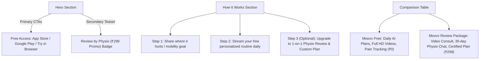

# SPEC-001: Free Exercise Streaming & Paid Physio Review Hero Experience

- **Linear Ticket:** [CORE-114](https://linear.app/moovv-fit/issue/CORE-114)
- **Parent Initiative:** [PDR-016: Free Content Access & Paid Physio Review Tier](repos/docs/product/docs/product/pdr/subscriptions-billing/PDR-016-FREE-CONTENT-ACCESS-AND-PAID-PHYSIO-REVIEW-TIER.md)
- **Target Repository:** `moovv-fit-landing` (`repos/apps/landing`)
- **Reviewers & Approvers:** 
  - **Pawan Deshmukh** (Clinical Integrity & Regulatory Boundaries)
  - **Rahul Jain** (Commercial Strategy, Positioning & Growth)
  - **Ujwal Parker** (Architecture & Delivery)

---

## 1. Executive Summary & Objective

In alignment with **PDR-016**, MoovvFit is replacing the legacy 7-day trial paywall with a **two-tier commercial architecture**:
1. **Tier 1 (Free Forever):** Full-length HD exercise streaming, AI intake, personalized daily mobility routines, and pain/completion tracking at ₹0.
2. **Tier 2 (High-Value Human Review):** Optional ₹499 (launch promo ₹299) **1-on-1 Physio Review Package** providing clinical teleconsultation, custom exercise modifications, and 30 days of asynchronous physio messaging.

**CORE-114** defines the landing page hero copy, value proposition messaging, trust indicators, and CTA hierarchy to communicate this shift cleanly without diluting top-of-funnel acquisition.

---

## 2. Strategic Constraints & Clinical Invariants

1. **No Medical Claims / Disease Diagnosis (Pawan Invariant):**
   - Copy must **never** claim that AI "cures" medical conditions or replaces physical therapy.
   - Algorithms match routines based on user-reported discomfort and movement patterns; diagnosis is strictly excluded (PDR-001).
   - "Unreviewed" vs. "Clinician Certified" distinction must be respected.
2. **Frictionless Top-of-Funnel Conversion (Rahul Invariant):**
   - The user must never feel bait-and-switched. Free exercise streaming is a genuine, permanent entitlement, not a restricted demo.
   - The ₹299 / ₹499 physio review is framed as an empowering clinical upgrade, not a blocker to working out.
3. **CTA Baseline Consistency:**
   - Must preserve the uniform 48px baseline buttons established in CORE-92 (`Download on App Store`, `Google Play`, `Try in Browser →`).

---

## 3. Proposed Copy Variations for Approval

We propose three distinct options for executive sign-off:

### Option A: Clinical Trust & Dual-Tier Focus (Recommended)
*Best for: Balancing medical credibility with zero-cost acquisition.*

- **Eyebrow Tag:** `Free Daily Mobility Plans • 1-on-1 Physio Review`
- **Headline (H1):**
  > **Daily movement plans built by AI.**  
  > **Certified by licensed physiotherapists.**
- **Subheadline (Hero Paragraph):**
  > Stream 100% free personalized mobility routines every single day — no subscription or credit card needed. Want tailored biomechanical guidance? Upgrade anytime to a 1-on-1 video review with a licensed physio for ₹299.
- **Trust Indicators (Pills under CTAs):**
  > `✓ 100% Free Daily Routines` • `✓ Verified Video Demonstrations` • `✓ Optional 1-on-1 Physio Review`

---

### Option B: Outcome & Pain-Relief Focus
*Best for: Direct consumer search intent (back pain, neck stiffness, desk workers).*

- **Eyebrow Tag:** `Physical Therapy Reimagined`
- **Headline (H1):**
  > **Move without pain.**  
  > **Starting today, 100% free.**
- **Subheadline (Hero Paragraph):**
  > Personalized daily routines designed by physical therapists to eliminate stiffness, protect joints, and keep you moving. Start exercising in your browser in seconds — or book an expert clinical review for personalized recovery.
- **Trust Indicators (Pills under CTAs):**
  > `Free Daily Routines Forever • Built with Licensed Clinicians • Available on Web, iOS & Android`

---

### Option C: Direct Habit & Dual-Action Focus
*Best for: Aggressive viral sharing and athletic / mobility clubs.*

- **Eyebrow Tag:** `Your Personal Mobility Coach`
- **Headline (H1):**
  > **Your daily routine is free.**  
  > **Your licensed physio is one click away.**
- **Subheadline (Hero Paragraph):**
  > Get daily exercise plans adapted to your body every morning at ₹0. When you need expert eyes on your injury or form, get a 1-on-1 teleconsultation and 30 days of direct chat with a licensed physio for ₹299.
- **Trust Indicators (Pills under CTAs):**
  > `Zero-Cost Guided Exercises • 1-on-1 Clinician Verification • Web, iOS & Android`

---

## 4. Section-by-Section Landing Changes

### Component Adjustments on `index.html`:
1. **Hero Headline & Subtitle**: Update `#heroSubtitle` and `h1`.
2. **CTA Bar**: Maintain 3 uniform 48px buttons (`App Store`, `Google Play`, `Try in Browser →`).
3. **Hero Trust Bar**: Replace generic text with the selected trust pill format.
4. **"How It Works" 3-Card Module**:
   - Card 1: *Share your symptoms or goal*
   - Card 2: *Exercise free every day with HD clinician-led videos*
   - Card 3: *Get your plan certified by a dedicated physiotherapist whenever you need it*

---

## 5. Review & Sign-Off Checklist

- [ ] **Pawan Deshmukh**: Approval of clinical disclaimer and absence of unverified curative claims.
- [ ] **Rahul Jain**: Selection of preferred Hero Copy variation (Option A, B, or C).
- [ ] **Ujwal Parker**: Verification of responsive mobile rendering and posthog tracking events (`cta_hero_free`, `cta_hero_review`).
