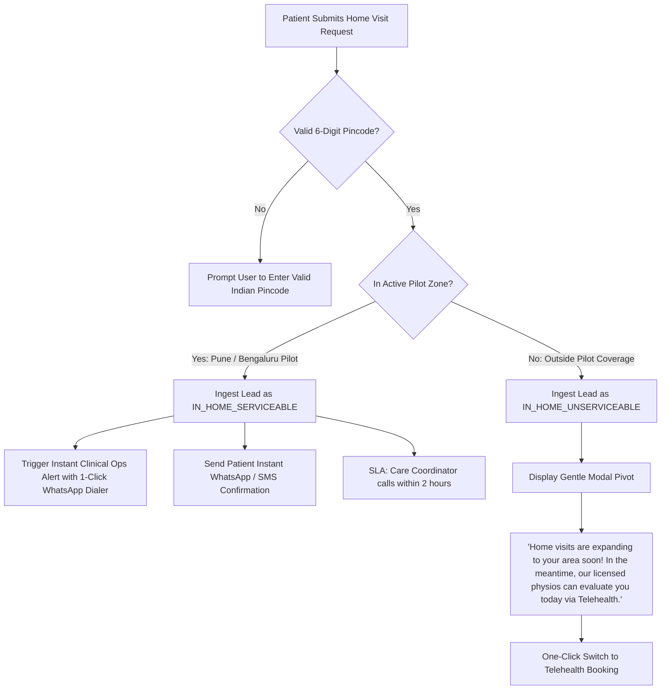
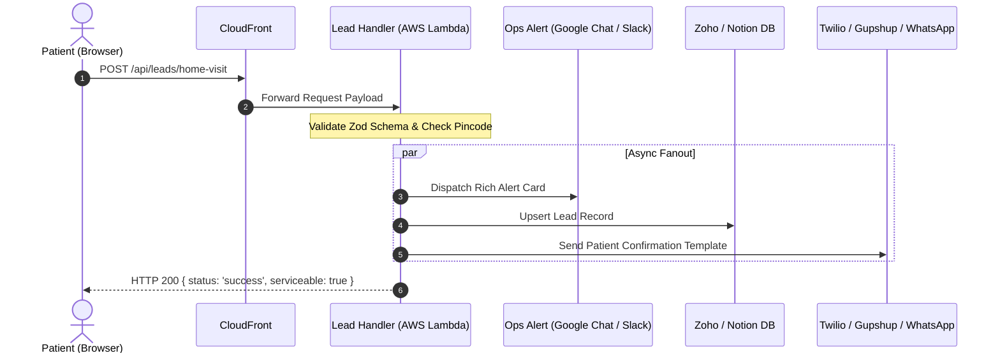

# SPEC-002: In-Home Consultation Lead Routing Webhook & Ops Notification Engine

- **Linear Ticket:** [CORE-115](https://linear.app/moovv-fit/issue/CORE-115)
- **Parent Initiative:** [PDR-016: Free Content Access & Paid Physio Review Tier](repos/docs/product/docs/product/pdr/subscriptions-billing/PDR-016-FREE-CONTENT-ACCESS-AND-PAID-PHYSIO-REVIEW-TIER.md)
- **Target Repositories:** `moovv-fit-landing`, `moovv-fit-infra` (Lambda Handler)
- **Reviewers & Approvers:**
  - **Pawan Deshmukh** (Clinical Ops Protocol, Pincode Triage & Safety)
  - **Rahul Jain** (Care Coordination SLA & Lead Conversion)
  - **Ujwal Parker** (Architecture & Webhook Security)

---

## 1. Executive Summary & Objective

In **PDR-016 (Section 2, Pathway A)**, users seeking direct professional care can request an **At-Home Physical Therapy Consultation** for elderly family members, severe post-operative mobility issues, or patients preferring in-person clinical assessment.

**CORE-115** specifies:
1. The **Lead Capture UI** on the consumer landing page.
2. The **Pincode Serviceability Engine** (distinguishing active pilot zones from out-of-area requests).
3. The **Serverless Webhook & Dispatch Pipeline** routing alerts to the clinical care coordination operations team (Slack/Google Chat + CRM).
4. The **Patient Auto-Confirmation Loop** (WhatsApp/SMS).

---

## 2. User Experience & Intake Form Specification

### Placement
- **Modal Entrypoint:** Header nav CTA button *"Book Home Visit"* and hero secondary action.
- **Dedicated Landing Sub-Route:** Accessible at `/home-visit/` (SEO landing page for local searches: *"Home visit physiotherapy in Pune / Bengaluru"*).

### Form Fields & Validation Rules

| Field Name | Type | Validation / Constraints | UI Label / Placeholder |
|---|---|---|---|
| `name` | String | 2 - 80 characters, sanitized | `Full Name` (e.g. Rahul Sharma) |
| `phone` | Tel | 10 digits (+91 implied, E.164 normalized) | `WhatsApp / Mobile Number` |
| `pincode` | Number | Exactly 6 digits (Indian postal code) | `Pincode` (e.g. 411038) |
| `locality` | String | 3 - 100 characters | `Locality / Apartment / Area` |
| `condition` | Select | Predefined enum | `Primary Concern`: <br>• Post-Surgery Rehab<br>• Acute Back / Neck Pain<br>• Knee / Joint Pain<br>• Elderly Mobility & Balance<br>• Sports Injury Recovery<br>• General Assessment |
| `preferred_slot`| Select | Enums: `morning`, `afternoon`, `evening` | `Preferred Visit Window`: <br>• Morning (9 AM – 1 PM)<br>• Afternoon (1 PM – 5 PM)<br>• Evening (5 PM – 8 PM) |
| `notes` | Text | Optional, max 500 characters | `Any specific details for the physiotherapist?` |
| `_gotcha` | Honeypot| Hidden field (must remain empty) | Anti-bot honeypot |

---

## 3. Pincode Serviceability & Smart Triage Fallback



### Pilot Serviceability Rules
- **Pune Pilot Pincodes:** `411001` through `411060`, `411038` (Kothrud), `411045` (Baner), `411057` (Wakad/Hinjawadi).
- **Bengaluru Pilot Pincodes:** `560001` through `560103` (Indiranagar, Koramangala, HSR Layout, Whitefield).
- **Unserviceable Graceful Fallback:** If the pincode falls outside the pilot cluster, the form does **not** reject the user with an error. Instead, it captures the lead for geo-expansion analytics and immediately offers an instant Telehealth appointment link.

---

## 4. Webhook Pipeline & Notification Architecture



### Ops Notification Card (Google Chat / Slack Payload)
When an in-home lead arrives, a structured card is dispatched immediately to `#clinical-ops-leads`:

```
🚨 NEW IN-HOME PHYSIO LEAD [SLA: 2 HOURS]
─────────────────────────────────────────────
👤 Patient:    Dr. Priya Sharma
📞 Contact:    +91 98765 43210 [📱 Open in WhatsApp]
📍 Location:   Kothrud, Pune (Pincode: 411038) - ✅ SERVICEABLE
🩺 Concern:    Post-Surgery Knee Rehabilitation
⏰ Preferred:  Morning (9 AM - 1 PM)
📝 Notes:      ACL reconstruction 3 weeks ago, needs gait training.
─────────────────────────────────────────────
[⚡ Claim Lead]  [📞 Log Call Attempt]  [📅 Assign Clinician]
```

---

## 5. Security, Anti-Abuse & Data Privacy

1. **Bot Mitigation:**
   - Honeypot `_gotcha` field (dropped silently if filled).
   - In-memory IP rate limiter on Lambda (maximum 5 submissions per IP per 15 minutes).
2. **DPDP Act Compliance (Pawan Review):**
   - Patient contact details are processed solely for clinical consultation fulfillment.
   - Data in transit encrypted via TLS 1.3; data at rest encrypted via AWS KMS in `ap-south-1`.

---

## 6. Operational SLAs & Escalation Protocol

- **Standard Daytime SLA (9 AM – 7 PM IST):** Care coordinator calls patient within **120 minutes**.
- **Evening Submissions (After 7 PM IST):** First contact before **10:30 AM IST** the following morning.
- **Escalation Trigger:** If an ops team member does not click `[Claim Lead]` or `[Log Call Attempt]` within 3 hours, an escalation ping alerts the lead clinical manager.

---

## 7. Review & Sign-Off Checklist

- [ ] **Pawan Deshmukh**: Approval of clinical concern categories and patient triage fallback to Telehealth.
- [ ] **Rahul Jain**: Approval of pilot pincodes, ops SLA (2-hour window), and WhatsApp confirmation copy.
- [ ] **Ujwal Parker**: Architecture review of serverless Lambda handler, KMS secrets, and webhook delivery reliability.
